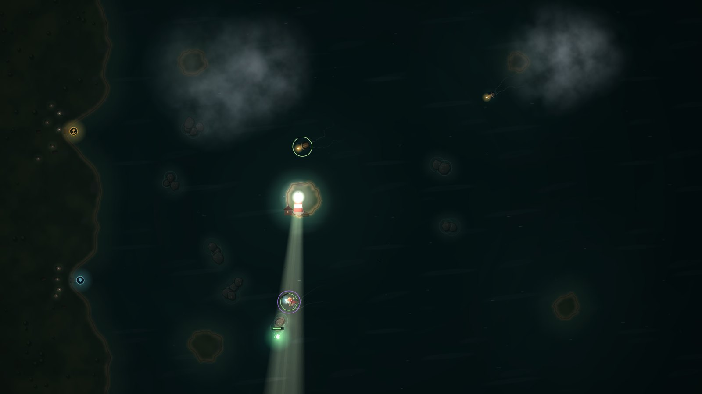
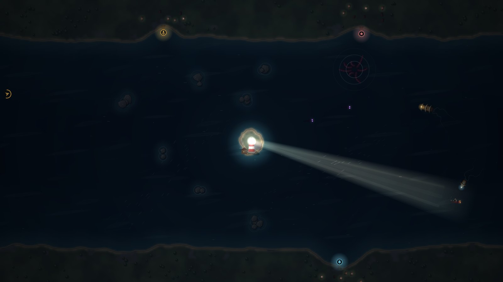

# Gloamlight

**Keep the lamp lit. Show the ships the rocks. Burn back what lives in the dark.**

Gloamlight is a lighthouse-keeper game for the browser. Ships come in off a black sea, bound for the harbour. While your beam is on them, their crews can see the rocks and steer the safe channel. In the dark they hold their last course, drift, and run onto whatever is in the way. You never steer a ship. You only decide who gets to see.

The dark is also alive. Shades latch onto hulls and gnaw. False lights lure lost ships onto the reefs. Krakens rise under the shipping lanes. Drowned galleons sail for your lamp to drink its oil. Every one of them burns in the light, and every second of light costs oil.



## Play

**Online:** https://vocal101.github.io/gloamlight/

**Offline / download:**
1. Click the green **Code** button on this page, then **Download ZIP**, and unzip it.
2. Open `index.html` in Chrome, Edge, Firefox or Safari.

No install and no build step. Once you have played it online, it is also cached for offline play, and you can add it to your home screen as an app.

## How to play

- **Aim the beam** with the mouse, or by dragging on a touch screen. Each ship's lantern shines in the colour of the pier it wants.
- **Light a ship** and it follows the safe channel home. A flashing **?** means it has lost its way.
- **Focus** (hold the left button, Shift or the Focus button) narrows the beam. It then reaches further and burns brighter, which you need for fog, far piers and big creatures. It also drinks oil much faster.
- **Oil** comes in with every ship that docks. Oil trawlers bring the most. A dry lamp shrinks to a weak glow.
- **Flares** (right click, F, or the Flare button) light a patch of sea for a while. Unlocked on Night 4.
- **The foghorn** (Space, or the Horn button) scatters shades and puts every lost ship back on course at once. Unlocked on Night 5.
- **Bell buoys** (a Workshop upgrade) are anchored at dusk, before you light the lamp.

A night is lost if too many ships are wrecked, or if the envoy's royal barque goes down. A night with no wrecks earns three stars.

### Controls

| Action | Mouse and keyboard | Touch |
| --- | --- | --- |
| Aim the beam | Move the mouse (or A/D, ←/→) | Drag anywhere |
| Focus | Hold left click, Shift or W | Hold **Focus** |
| Flare | Right click or F | Tap **Flare**, then tap the sea |
| Foghorn | Space | Tap **Horn** |
| Pause | Esc or P | ❚❚ button |

## What's in it

- **A 20-night campaign** across four postings: Saltmere Cove, Hollowfen Reach, Thornback Strait and the Drowned Crown, ending with a boss.
- **Five kinds of creature** and **six kinds of ship**, plus fog banks, tide races and thunderstorms. Lightning shows every ship the rocks for a moment.
- **The Workshop**: 12 lighthouse upgrades, including a better lens, wider reflector, faster gearing, a bigger cistern, a hotter wick, flares, bell buoys, harbour lanterns, pilot charts and a twin lens.
- **The Long Night**: an endless mode with a record to beat.
- **A Logbook** with the keeper's journal (the story of what happened to old Ansel), 19 marks to earn, and lifetime records.
- Fully synthesized sound: a breathing sea, wind and rain, generative music that tightens when something is hunting, and a proper foghorn.
- Settings for volume, screen shake, gentler lightning flashes, tutorial hints, and shape badges for players who find the pier colours hard to tell apart.



## For developers

Plain HTML, CSS and JavaScript. No dependencies.

```bash
npm test                 # map checks, every night played by the AI keeper, an endless run, rule checks
npm run campaign         # plays the whole campaign with a mid-skill AI, buying upgrades between nights
npm run serve            # local server on http://localhost:8780 (add ?dev for the test harness)
```

| File | What it does |
| --- | --- |
| `js/data.js` | Regions, ships, creatures, all 20 nights, upgrades, story text and achievements |
| `js/map.js` | Coastlines from noise, reef placement, distance fields and per-pier flow fields |
| `js/sim.js` | The night simulation: light, ships, creatures, weather and the rules (no DOM, runs in Node) |
| `js/bot.js` | The AI keeper used by the tests and the title screen |
| `js/render.js`, `js/art.js`, `js/fx.js` | Canvas renderer, with a darkness layer that the light is cut out of |
| `js/audio.js` | WebAudio sound and music |
| `js/game.js`, `js/ui.js`, `js/main.js` | Match control, screens and HUD, app flow and progress |

Progress is saved in the browser (`localStorage`).

## Credits

All art is drawn in code and all sound is synthesized in the browser. Fonts: IBM Plex (SIL Open Font License, see `fonts/LICENSE-IBM-Plex.txt`).
